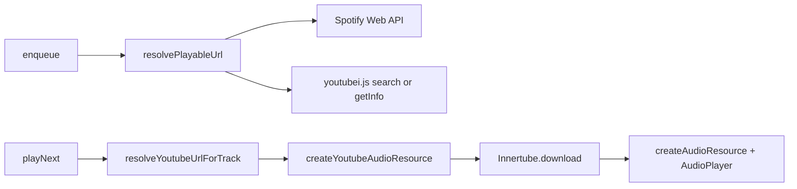

# Replace play-dl with youtubei.js

Keep [GuildMusicSession](src/infra/music/guild-music-session.ts) as the player. Swap only the YouTube adapter: validate / search / playlist / stream currently done by `play-dl` in three infra files.

**Out of scope:** DisTube, discord-player, Lavalink, yt-dlp fallback, PO-token auto-generation (`bgutils-js`). Optional `YOUTUBE_PO_TOKEN` / `YOUTUBE_VISITOR_DATA` env passthrough only.

## Constraint: CJS build + ESM library

The project compiles to CommonJS ([tsconfig.json](tsconfig.json) `"module": "commonjs"`). `youtubei.js` is ESM-only, so a top-level `require` after `yarn build` will fail.

Isolate all Innertube usage behind one module that loads it with `await import('youtubei.js')`. Call that from the existing startup hook in [src/main/server.ts](src/main/server.ts) (today `bootstrapPlayDl()`).

## 1. Innertube singleton

Add [src/infra/music/youtube-client.ts](src/infra/music/youtube-client.ts):

- `bootstrapYoutubeClient()` reads `YOUTUBE_COOKIE` / `BOT_YOUTUBE_COOKIE` (reuse [validateYoutubeCookieFormat](src/infra/music/youtube-cookie-validation.ts)), plus optional `YOUTUBE_PO_TOKEN` and `YOUTUBE_VISITOR_DATA`.
- `Innertube.create({ cookie, po_token, visitor_data })`.
- `getYoutubeClient()` returns the created instance; throw a clear error if bootstrap was skipped.
- Cookie still optional at startup (same warn-and-continue behavior as [bootstrap-play-dl.ts](src/infra/music/bootstrap-play-dl.ts)), because YouTube may work without it on some hosts.

Replace [src/infra/music/bootstrap-play-dl.ts](src/infra/music/bootstrap-play-dl.ts) with this bootstrap (or rename and point `server.ts` at it). Update cookie-validation comments that still mention `play.setToken`.

## 2. Classify URLs without play-dl

`play.validate()` is the only classifier today. Add a small pure helper (e.g. [src/infra/music/classify-playable-url.ts](src/infra/music/classify-playable-url.ts)) that maps a string to:

- YouTube video (`watch`, `youtu.be`, `shorts`) — extract video id
- YouTube playlist (`playlist?list=` only; a `watch?v=&list=` URL stays a **single video**, matching current behavior)
- Spotify track / playlist / album — keep existing [parseSpotifyUrl](src/infra/music/resolve-playable-url.ts) regexes
- SoundCloud / Deezer → `UnsupportedSource`
- otherwise → search query

Share video-id extraction with stream creation (today [normalizeYoutubeUrl](src/infra/music/youtube-audio-resource.ts) lives next to play-dl).

## 3. Rewrite the three play-dl call sites

Keep exported function names so [guild-music-session.ts](src/infra/music/guild-music-session.ts) does not change.

**[resolve-playable-url.ts](src/infra/music/resolve-playable-url.ts)** — drop `import play from 'play-dl'`. Spotify path unchanged. YouTube:

- video → `getBasicInfo` / `getInfo`; skip lives (`LiveUnsupported`)
- playlist → Innertube playlist fetch; skip live items; keep `playlistName`
- search → first video hit or `SearchIsNull`

**[resolve-youtube-for-track.ts](src/infra/music/resolve-youtube-for-track.ts)** — if `track.youtubeUrl` exists, return it; else search `youtubeSearchQuery` (Spotify bridge) via Innertube.

**[youtube-audio-resource.ts](src/infra/music/youtube-audio-resource.ts)** — no play-dl attempt loop. Flow:

1. Parse video id from the watch URL.
2. `info = await yt.getInfo(id)` (try a second InnerTube client such as `ANDROID` / `TV` if the first fails).
3. Reject lives.
4. `const webStream = await info.download({ type: 'audio', quality: 'best' })`.
5. Convert Web `ReadableStream` → Node `Readable` (`Readable.fromWeb`) and `createAudioResource(..., { inputType: StreamType.Arbitrary, inlineVolume: true })`.

Preserve volume scaling (`volumePercent / 100`, clamped 0–2). Map missing formats / empty streams to `VideoUnavailable` so existing [discord-errors](src/presentation/helpers/discord-errors/discord-errors.ts) copy still applies.

## 4. Script, copy, deps, docs

- [scripts/validate-youtube-cookie.ts](scripts/validate-youtube-cookie.ts): bootstrap Innertube, then `getBasicInfo` on the same probe video (`jNQXAC9IVRw`). Keep `yarn validate:youtube-cookie`.
- User-facing YouTube 403 hint in [discord-errors.ts](src/presentation/helpers/discord-errors/discord-errors.ts): drop `play-dl setToken`; mention `YOUTUBE_COOKIE` (and optional PO token). Update [discord-errors.spec.ts](src/presentation/helpers/discord-errors/discord-errors.spec.ts) only if the assertion string changes.
- `yarn add youtubei.js` and `yarn remove play-dl`.
- [AGENTS.md](AGENTS.md): player is `@discordjs/voice` + `GuildMusicSession`; YouTube via `youtubei.js`; env table for cookies / PO token / Spotify; drop DMP and “play-dl as DMP peer”.

## 5. Tests

[vitest.config.ts](vitest.config.ts) already **excludes** `src/infra/music/**` from coverage, so CI 100% thresholds stay green without covering the session. Still add focused specs that **run** in `yarn test`:

- URL classifier (pure, no network): video / playlist / shorts / Spotify / search / unsupported.
- Resolve + stream modules with a **mocked** `getYoutubeClient()` (no live YouTube): live reject, empty search → `SearchIsNull`, download → `createAudioResource` inputs.
- Existing cookie-format spec stays.

Do not lift the coverage exclude in this pass (that would force 100% on `GuildMusicSession`).

## Verification

- `yarn build` (CJS emit must not `require('youtubei.js')` statically).
- `yarn test` and `yarn test:ci`.
- `yarn validate:youtube-cookie` against the existing `.env` cookie (network; may still 403 without a PO token — that is a follow-up, not a blocker for the swap).
