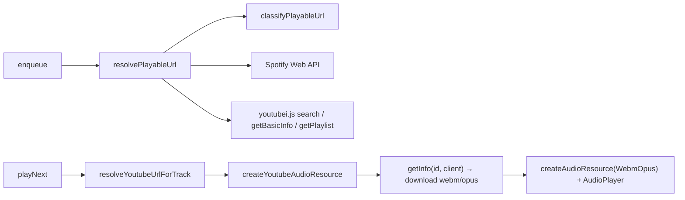

# Replace play-dl with youtubei.js

Keep [GuildMusicSession](src/infra/music/guild-music-session.ts) as the player. Swap only the YouTube adapter: validate / search / playlist / stream currently done by `play-dl` in three infra files.

**Out of scope:** DisTube, discord-player, Lavalink, yt-dlp fallback, and the "every queued track fails in a row when YouTube blocks us" cascade in `playNext` (follow-up). PO-token generation was added afterwards (section 7).

## Constraint: CJS build + ESM library

The project compiles to CommonJS ([tsconfig.json](tsconfig.json) `"module": "commonjs"`, default `node10` resolution). `youtubei.js` is ESM-only.

- With this config TypeScript rewrites `await import('youtubei.js')` into `require('youtubei.js')`. That is fine on **Node ≥ 22.12**, which loads ESM synchronously through `require()` (no top-level await in the package). Bump `engines.node` to `>=22.12`.
- Types resolve through the package's top-level `types` field; use type-only imports at module scope and load the runtime once, lazily, inside `youtube-client.ts`.
- Verify by running the compiled `dist/` once, not only `tsx`.

## 1. Innertube client

Add [src/infra/music/youtube-client.ts](src/infra/music/youtube-client.ts):

- `getYoutubeClient(): Promise<Innertube>` — created on first call and memoized as a promise; a failed creation clears the memo so the next call retries. No "bootstrap was skipped" error.
- `bootstrapYoutubeClient()` — logs cookie status and warms the client at startup (warn-and-continue on failure, like [bootstrap-play-dl.ts](src/infra/music/bootstrap-play-dl.ts)). `server.ts` calls it instead of `bootstrapPlayDl()`.
- Reads `YOUTUBE_COOKIE` / `BOT_YOUTUBE_COOKIE` (with `||`, so an empty first var falls through; reuse [validateYoutubeCookieFormat](src/infra/music/youtube-cookie-validation.ts)), optional `YOUTUBE_PO_TOKEN`, `YOUTUBE_VISITOR_DATA`.
- `Innertube.create({ cookie, po_token, visitor_data, retrieve_player: true, cache: new UniversalCache(false) })`.
- **JS evaluator (required):** youtubei.js 18 ships no JavaScript interpreter; its default `Platform.shim.eval` throws, so stream URLs can't be deciphered. Install one via `Platform.load({ ...Platform.shim, eval })` that runs the extracted player script in a `node:vm` context (fresh globals, timeout) and returns `process(n, sp, sig)`.

## 2. Classify URLs without play-dl

`play.validate()` is the only classifier today. Add a pure helper at [src/infra/media-url/classify-playable-url.ts](src/infra/media-url/classify-playable-url.ts) (outside the `src/infra/music/**` coverage exclude, so it gets real 100% coverage) that maps a string to:

- YouTube video (`watch?v=`, `youtu.be`, `shorts`, `live`, `embed`; `m.`/`music.` hosts) — extract the 11-char video id
- YouTube playlist (`/playlist?list=` only; a `watch?v=&list=` URL stays a **single video**, matching current behavior, which also covers auto-generated mixes)
- Spotify track / playlist / album — moves the existing `parseSpotifyUrl` regexes here
- SoundCloud / Deezer / other YouTube or Spotify pages / any other URL → `unsupported`
- anything that is not a URL → search query

Also export `extractYoutubeVideoId()` for stream creation (replaces `normalizeYoutubeUrl`).

## 3. Rewrite the three play-dl call sites

Keep exported function names so [guild-music-session.ts](src/infra/music/guild-music-session.ts) does not change.

Shared helper [src/infra/music/youtube-search.ts](src/infra/music/youtube-search.ts): normalizes search/playlist nodes (`Video`, `PlaylistVideo`, `LockupView` with `content_type: 'VIDEO'`) into one summary shape, plus `searchFirstYoutubeVideo(query)`.

**[resolve-playable-url.ts](src/infra/music/resolve-playable-url.ts)** — drop `import play from 'play-dl'`; Spotify path unchanged. YouTube:

- video → `getBasicInfo(id)`; skip lives (`LiveUnsupported`)
- playlist → `getPlaylist(id)` and follow `getContinuation()` up to a 500-track cap; skip live/unplayable items; keep `playlistName`
- search → first video hit or `SearchIsNull`

**[resolve-youtube-for-track.ts](src/infra/music/resolve-youtube-for-track.ts)** — if `track.youtubeUrl` exists, return it; else `searchFirstYoutubeVideo(youtubeSearchQuery)`.

**[youtube-audio-resource.ts](src/infra/music/youtube-audio-resource.ts)** — no play-dl attempt loop. Flow:

1. Parse the video id (`extractYoutubeVideoId`), else `VideoUnavailable`.
2. For each client in `YOUTUBE_CLIENTS` (comma list, default `MWEB,IOS,TV_SIMPLY`, chosen from a live probe): `info = await yt.getInfo(id, { client })`; reject lives; try the next client on failure.
3. Read the first chunk before returning (`primeStream`): YouTube often rejects a client only when media bytes are requested (HTTP 403), and that must happen inside the loop so the next client is tried.
4. **Prefer WebM/Opus:** `info.download({ type: 'audio', quality: 'best', format: 'webm', codec: 'opus' })` → `StreamType.WebmOpus` (demuxed by prism-media, **no ffmpeg needed** — the Docker image `node:latest` has none). Only if no Opus format exists, fall back to `format: 'any'` + `StreamType.Arbitrary` (needs ffmpeg).
5. Wrap the primed web stream in a Node `Readable` → `createAudioResource(..., { inlineVolume: true })`.

Preserve volume scaling (`volumePercent / 100`, clamped 0–2).

## 4. Errors

Add a pure `toYoutubeFailureCode(err)` next to the classifier: an HTTP 403 media response (`err.info.response.status`) or bot-check / sign-in / login-required / age-restricted messages → `YoutubeBlocked`; anything else → `VideoUnavailable`. Stream creation throws that code after the last client fails.

In [discord-errors.ts](src/presentation/helpers/discord-errors/discord-errors.ts) replace the play-dl-specific `ERR_INVALID_URL` hint with a `YoutubeBlocked` case that mentions `YOUTUBE_COOKIE` (and optional `YOUTUBE_PO_TOKEN`); update [discord-errors.spec.ts](src/presentation/helpers/discord-errors/discord-errors.spec.ts).

## 5. Script, deps, docs

- [scripts/validate-youtube-cookie.ts](scripts/validate-youtube-cookie.ts): use `getYoutubeClient()`, then `getBasicInfo` on the probe video (`jNQXAC9IVRw`) **and** read the first bytes of the audio stream, so deciphering is actually exercised. Keep `yarn validate:youtube-cookie`.
- `yarn add youtubei.js` and `yarn remove play-dl`; `engines.node` → `>=22.12`.
- [AGENTS.md](AGENTS.md): player is `@discordjs/voice` + `GuildMusicSession`; YouTube via `youtubei.js`; env table for cookies / PO token / clients / Spotify; drop DMP and "play-dl as DMP peer".

## 6. Tests

[vitest.config.ts](vitest.config.ts) excludes `src/infra/music/**` from coverage; leave that as is.

- URL classifier + failure mapping (pure, 100% covered): video / playlist / shorts / Spotify / search / unsupported.
- Resolve + stream modules with a **mocked** `getYoutubeClient()` (no live YouTube): live reject, empty search → `SearchIsNull`, playlist pagination, client fallback, WebM/Opus → `createAudioResource` inputs.
- Existing cookie-format spec stays.

## Verification

- `yarn build`, then load the compiled `dist/infra/music` modules under plain `node` to confirm the CJS → ESM load works.
- `yarn test` and `yarn test:ci`.
- `yarn validate:youtube-cookie` (network; may still fail without a PO token — follow-up, not a blocker).

## Findings from the live probe (2026-10-28, no cookie / PO token)

- Search, single-video metadata and playlists (with continuation) all work anonymously.
- Streaming: `MWEB`, `IOS`, `TV_SIMPLY` succeed for ordinary uploads; `WEB` / `ANDROID` fail to decipher, `TV` / `WEB_EMBEDDED` report the video unplayable.
- **Label-owned music videos (e.g. VEVO / official music videos) return HTTP 403 on the media request for every client** without a cookie or PO token. These surface as `YoutubeBlocked`. Fixed by PO-token generation (section 7).
- **With a logged-in cookie:** `IOS`, `TV_SIMPLY` and `ANDROID*` answer HTTP 400 to the player request (app clients reject cookie auth); `MWEB` and `YTMUSIC` keep working. The cookie does **not** unlock the label-owned music videos (still 403), so the default client list depends on whether a cookie is set.
- A full 3:34 track downloads in about 3s as WebM/Opus (no throttling).
- Correction (found in the Docker image, which has no ffmpeg): passing `StreamType.WebmOpus` with `inlineVolume` makes @discordjs/voice choose its ffmpeg route (cost 4 vs 4.5). The stream is now demuxed in our code and handed over as `StreamType.Opus`, which needs no ffmpeg.
- The `youtubei.js` parser logs a warning for every unknown YouTube UI node; the client sets `Log.setLevel(Log.Level.ERROR)`.

## 7. PO token generation (follow-up, done)

Label-owned music videos return HTTP 403 on the media request for every client, with or without a cookie, unless a proof-of-origin token is supplied. Implemented in [src/infra/music/youtube-po-token.ts](src/infra/music/youtube-po-token.ts):

- `yt.getAttestationChallenge('ENGAGEMENT_TYPE_UNBOUND')` → load the BotGuard interpreter into a **jsdom window** (`runScripts: 'outside-only'`, so the bot's globals are untouched) → `BotGuardClient.snapshot` → WAA `GenerateIT` integrity token (TTL ~12h) → WebPO minter (~0.4s total).
- The minter comes from the jsdom realm, so bgutils' `WebPoMinter` (`instanceof Function/Uint8Array`) can't be used; minting uses `typeof` checks and window-realm `Uint8Array`s.
- Shared minter, renewed 10 min before expiry; 5 min backoff after a failed BotGuard run (playback continues without tokens). Warmed at startup by `bootstrapYoutubeClient`.
- Live probe results (which token works where):
  - **YTMUSIC + video-bound token as the stream URL `pot`** plays blocked music videos, logged in or out. `youtubei.js` takes `pot` from the shared Player, so `withStreamPoToken` swaps it under a lock just for `download()`'s decipher step.
  - **TV_SIMPLY + visitor-bound session token** also works when logged out (set on `session.po_token` / `player.po_token` when the minter is created).
  - MWEB stays 403 for those videos with any token; it remains first because it needs no token for ordinary uploads.
- The video-bound token is also sent in the player request (`getInfo(id, { po_token })`).
- `YOUTUBE_PO_TOKEN_GENERATION=false` disables it; a static `YOUTUBE_PO_TOKEN` also disables generation.
- `yarn validate:youtube-cookie` now also reports PO token status and probes an official music video.
